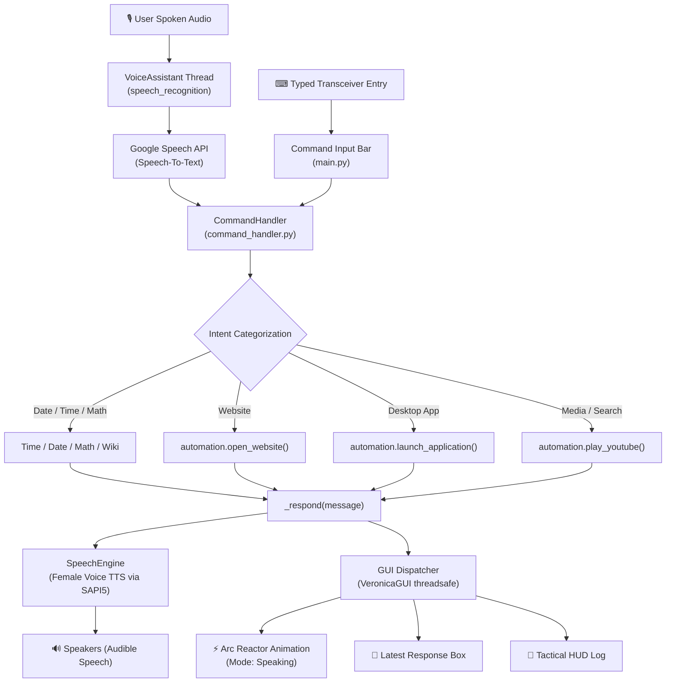

# 📖 VERONICA AI VOICE ASSISTANT — COMPLETE CODE EXPLANATION GUIDE

> **Author:** Mohd Sarim Khan  
> **Organization:** Pynexia Technology  
> **System:** VERONICA Tactical AI Desktop Voice Assistant (MK-IV)  
> **Target Audience:** Developers, Reviewers, Viva Evaluators, and Internship Supervisors

---

## 📑 Table of Contents
1. [Executive Summary & High-Level Architecture](#1-executive-summary--high-level-architecture)
2. [Data Flow & Concurrency Pipeline](#2-data-flow--concurrency-pipeline)
3. [Deep-Dive Code Breakdown File-by-File](#3-deep-dive-code-breakdown-file-by-file)
   - [A. `config.py` — Central Constants & HUD Theme](#a-configpy--central-constants--hud-theme)
   - [B. `speech_engine.py` — Female Voice Synthesis Engine](#b-speech_enginepy--female-voice-synthesis-engine)
   - [C. `command_handler.py` — Natural Language Intent Parser & Knowledge Engine](#c-command_handlerpy--natural-language-intent-parser--knowledge-engine)
   - [D. `automation.py` — Web & Windows Application Automation](#d-automationpy--web--windows-application-automation)
   - [E. `voice_assistant.py` — Acoustic Microphone Listener & STT](#e-voice_assistantpy--acoustic-microphone-listener--stt)
   - [F. `main.py` — Iron Man HUD Interface & Arc Reactor Canvas](#f-mainpy--iron-man-hud-interface--arc-reactor-canvas)
   - [G. `test_assistant.py` & `test_system_integration.py` — Automated Test Harnesses](#g-test_assistantpy--test_system_integrationpy)
   - [H. `run_veronica.bat` — Windows Batch Launcher](#h-run_veronicabat)
4. [Critical Technical Challenges Solved](#4-critical-technical-challenges-solved)
5. [Viva & Technical Interview Q&A](#5-viva--technical-interview-qa)

---

## 1. Executive Summary & High-Level Architecture

VERONICA is a modular, event-driven desktop AI voice assistant engineered in Python. It blends three foundational pillars:
1. **Acoustic Perception:** Listens to ambient user speech through the microphone, filters background noise, and transcribes spoken audio via Google Speech Recognition.
2. **Cognitive Intent Parsing & Action Execution:** Normalizes user phrasing using regular expressions, determines the target intent, queries data (time, date, math, Wikipedia), launches desktop applications, or opens websites.
3. **Multimodal Output (Female Voice & Holographic HUD):** Speaks responses out loud using an expressive female voice (Microsoft Zira SAPI-5) while simultaneously driving an animated Iron Man Arc Reactor interface running at 30 FPS.



---

## 2. Data Flow & Concurrency Pipeline

### Why Multithreading is Mandatory
In desktop GUI frameworks like Tkinter and CustomTkinter, the graphical interface runs inside a **single-threaded Event Loop** (`mainloop`). 
- If a program performs network requests (e.g., Google Speech API, YouTube playback) or executes Text-to-Speech audio on the main thread, the entire window freezes, turns white, and shows Windows' dreaded `(Not Responding)`.
- **The Solution:** VERONICA employs a strict **decoupled threading model**:
  1. **Thread 1 (Main Thread):** Dedicated solely to the CustomTkinter GUI event loop, clock updates, and the 30-FPS Arc Reactor canvas animation.
  2. **Thread 2 (Microphone Worker):** Continuously captures audio buffers and communicates with the Google Speech API.
  3. **Thread 3 (Execution Worker):** Spawns dynamically to process intents, compute math, and trigger external applications.
  4. **Thread 4 (TTS Speech Worker):** Synthesizes audio waveforms and plays them through the Windows sound device.
  5. **Thread-Safe Dispatching:** Whenever background worker threads need to modify the UI (e.g., update text or change colors), they call `self.after(0, _callback)`. This schedules the UI change safely onto the main thread without race conditions.

---

## 3. Deep-Dive Code Breakdown File-by-File

---

### A. `config.py` — Central Constants & HUD Theme

#### Purpose
Acts as the **Single Source of Truth** for global settings, metadata, application paths, supported web URLs, and UI color palettes. Separating configuration from logic prevents hardcoding and allows instant re-theming.

#### Key Code Elements & Explanations:
```python
ASSISTANT_NAME: str = "Veronica"
ASSISTANT_TAGLINE: str = "ORBITAL INTELLIGENCE & TACTICAL HUD SYSTEM — MK-IV"
```
- Sets the assistant's name to **Veronica** and establishes the Iron Man military/tactical theme.

```python
WEBSITE_URLS: Dict[str, str] = {
    "youtube": "https://www.youtube.com",
    "google": "https://www.google.com",
    "gmail": "https://mail.google.com",
    "github": "https://www.github.com",
    "linkedin": "https://www.linkedin.com",
    "stack overflow": "https://stackoverflow.com",
    "naukri": "https://www.naukri.com",
    "instagram": "https://www.instagram.com",
    "facebook": "https://www.facebook.com",
}
```
- A dictionary mapping lowercase aliases to full HTTPS endpoints for all 8 required websites.

```python
APP_COMMANDS: Dict[str, str] = {
    "notepad": "notepad.exe",
    "calculator": "calc.exe",
    "paint": "mspaint.exe",
    "command prompt": "cmd.exe",
    "file explorer": "explorer.exe",
    "visual studio code": "code",
    "settings": "ms-settings:",
}
```
- Maps user voice labels to Windows system binaries and protocol URIs (`ms-settings:` opens the Windows Settings Universal app).

```python
BG_COLOR_DARK: str = "#050811"       # Deep Space Obsidian
PANEL_BG: str = "#080e1b"            # Cockpit Glass Dark Slate
ACCENT_COLOR: str = "#00f0ff"        # Holographic Cyan / Electric Arc
ACCENT_GOLD: str = "#ffb800"         # Arc Reactor Gold / Iron Man Gold
STATUS_LISTENING: str = "#00ff9d"     # Quantum Emerald Green
```
- Exact color hex codes reproducing the holographic Iron Man HUD aesthetic.

---

### B. `speech_engine.py` — Female Voice Synthesis Engine

#### Purpose
Converts textual responses into spoken verbal audio. Ensures that **Veronica always speaks out loud using a female voice** and never leaves answers trapped in the terminal.

#### How It Works (The SAPI-5 Architecture):
On Windows, Text-To-Speech is managed by the Microsoft Speech API (SAPI-5). Standard Python libraries like `pyttsx3` often crash on modern Windows 10/11 because `pyttsx3` blindly calls `GetVoices()` which encounters corrupted registry tokens from Windows OneCore. 

To overcome this, `speech_engine.py` implements a **direct SAPI-5 token stream architecture**:
1. Uses `comtypes.client` to query the registry category `HKEY_LOCAL_MACHINE\SOFTWARE\Microsoft\Speech\Voices`.
2. Searches installed tokens specifically for female voices (matching keywords `"zira"`, `"female"`, or `"hazel"`).
3. Selects **`Microsoft Zira Desktop - English (United States)`**.
4. Opens an `SAPI.SpFileStream` to generate the spoken audio buffer into a temporary `.wav` file.
5. Invokes `winsound.PlaySound()` (a native Windows audio endpoint in Python's standard library) to play the speech cleanly.
6. Cleans up the temporary audio file immediately after playback.

#### Key Functions Explained:
- `_check_voice_support()`: Queries available Windows voice tokens during startup to confirm the presence of Microsoft Zira.
- `set_rate(rate)`: Normalizes Words Per Minute (100–250 WPM) and maps it linearly to SAPI-5's internal integer scale (`-10` to `+10`):
  $$\text{SAPI Rate} = \text{int}\left(\frac{\text{WPM} - 175}{15}\right)$$
- `set_volume(volume)`: Clamps volume between `0.0` and `1.0`, then multiplies by 100 for SAPI-5 (`0` to `100`).
- `speak(text, block=True)`: 
  - Immediately triggers `on_speak_callback(text)` so the text appears in the UI hero box before the audio starts.
  - Spawns the speech generation inside a thread-safe `_execute_speech()` block protected by `threading.Lock()`.
  - Sets `self._is_speaking = True` so the Arc Reactor visualizer switches to its energetic speaking animation.

---

### C. `command_handler.py` — Natural Language Intent Parser & Knowledge Engine

#### Purpose
Analyzes the text captured from the user, cleans conversational filler, identifies intent, executes actions, and produces the final spoken statement.

#### 1. Command Preprocessing (`preprocess_command`)
Users rarely speak like robots. Instead of saying `"time"`, they say:
- *"Veronica, what is the time?"*
- *"Can you please tell me what the time is?"*
- *"Hey Veronica, what time is it?"*

The `preprocess_command` function strips punctuation and uses a compiled list of regular expression patterns to discard conversational prefixes:
```python
prefixes = [
    r"^hey\s+veronica\s*,?\s*",
    r"^veronica\s*,?\s*",
    r"^can\s+you\s+please\s+",
    r"^could\s+you\s+",
    r"^tell\s+me\s+",
]
```
Result: *"Veronica, can you please tell me the time"* is cleanly normalized into `"time"`.

#### 2. Intent Routing Ladder (`process` method)
The method evaluates commands through an ordered priority ladder:
1. **Shutdown / Exit:** `"exit"`, `"quit"`, `"goodbye"` $\rightarrow$ speaks farewell and triggers `on_exit_callback()`.
2. **Clear HUD:** `"clear history"`, `"clear screen"` $\rightarrow$ wipes GUI logs and verbally confirms.
3. **Repeat:** `"repeat that"`, `"say again"` $\rightarrow$ speaks `self.last_response`.
4. **Greetings:** `"hello"`, `"hi"`, `"hey"` $\rightarrow$ calculates current hour and gives time-appropriate greetings (*"Good morning!"*, *"Good afternoon!"*, etc.).
5. **System Diagnostics:** `"system status"`, `"diagnostics"` $\rightarrow$ reports system health, voice synthesis model, and sensor status.
6. **Date & Time (Verbal Output):**
   - `"time"` $\rightarrow$ extracts `datetime.now().strftime("%I:%M %p")` and responds: *"The current time is 04:05 PM, sir."*
   - `"date"` $\rightarrow$ extracts `datetime.now().strftime("%A, %B %d, %Y")` and responds: *"Today's date is Thursday, November 19, 2026, sir."*
   - `"day"` $\rightarrow$ extracts day of week and responds: *"Today is Thursday, sir."*
7. **Math Arithmetic Engine (`_try_simple_math`):**
   - Detects queries like *"calculate 25 times 4"* or *"what is 100 divided by 5"*.
   - Replaces word operators with mathematical symbols (`"times"` $\rightarrow$ `"*"`, `"plus"` $\rightarrow$ `"+"`).
   - Validates the string using regex `^[\d\s\+\-\*\/\.\(\)]+$` to ensure only numbers and safe math operators exist.
   - Evaluates the result and speaks: *"The calculated result is 100, sir."*
8. **Wikipedia Intelligence (`_try_wikipedia`):**
   - For queries like *"Who is Tony Stark?"* or *"What is machine learning?"*, fetches a concise 2-sentence summary using `wikipedia.summary()` and speaks it aloud.
   - If offline, falls back gracefully to opening Google search without crashing.
9. **Website Automation:** Checks `WEBSITE_URLS` and delegates to `automation.open_website()`.
10. **Application Automation:** Checks `APP_COMMANDS` and delegates to `automation.launch_application()`.
11. **Media Playback:** Calls `automation.play_youtube()` for `"play believer"`.
12. **Web Search:** Calls `automation.google_search()` for `"search python programming"`.

---

### D. `automation.py` — Web & Windows Application Automation

#### Purpose
Encapsulates low-level Operating System and browser interactions with proper exception handling.

#### Key Functions Explained:
- `open_website(site_key)`: Looks up the target URL and invokes `webbrowser.open_new_tab(url)`. Returns `(True, "Opening Youtube in your browser, sir.")`.
- `launch_application(app_name)`:
  - If target is a protocol URI like `ms-settings:`, uses `os.system("start ms-settings:")`.
  - For command line or GUI applications (`notepad.exe`, `calc.exe`), invokes `subprocess.Popen(cmd, shell=True)`.
  - **Why `Popen` instead of `subprocess.run`?** `subprocess.run` blocks execution until the launched application is closed by the user! `subprocess.Popen` launches the application as an independent background process, allowing the assistant to return immediately.
- `play_youtube(query)`:
  - Attempts playback via `pywhatkit.playonyt(query)`, which automatically scrapes and plays the top YouTube video.
  - If `pywhatkit` encounters a network glitch, falls back to URL encoding the query: `https://www.youtube.com/results?search_query={encoded}` and opens it directly in a new browser tab.
- `google_search(query)`: Encodes query strings using `urllib.parse.quote()` and opens `https://www.google.com/search?q={query}`.

---

### E. `voice_assistant.py` — Acoustic Microphone Listener & STT

#### Purpose
Manages the real-time background microphone thread, handles speech thresholding, and translates human acoustic speech into text strings.

#### How It Works:
1. **Microphone Device Initialization:** Binds to the system's default recording endpoint using `speech_recognition.Microphone()`.
2. **Ambient Noise Calibration:** 
   ```python
   self.recognizer.adjust_for_ambient_noise(source, duration=0.8)
   ```
   Before listening, listens to room noise for 0.8 seconds and calculates a dynamic energy threshold. This prevents background computer fans or room hum from triggering accidental recognition.
3. **Continuous Audio Capture:**
   ```python
   audio = self.recognizer.listen(source, timeout=5, phrase_time_limit=8)
   ```
   - `timeout=5`: Checks every 5 seconds if the user stopped listening (allowing clean thread termination).
   - `phrase_time_limit=8`: Limits single command phrases to 8 seconds to prevent memory overflow.
4. **Google Web Speech Translation:** Sends raw PCM audio bytes to Google's Speech-To-Text API with `language="en-IN"`.
5. **Exception Handling:**
   - `WaitTimeoutError`: User didn't speak within 5 seconds; quietly loops back without error.
   - `UnknownValueError`: User murmured unintelligibly; sets status to `"Speech Unclear"` and waits for another attempt.
   - `RequestError`: Internet connection dropped; speaks a polite warning: *"I am having trouble reaching the speech recognition servers..."*.

---

### F. `main.py` — Iron Man HUD Interface & Arc Reactor Canvas

#### Purpose
Constructs the complete graphical interface using **CustomTkinter** and paints the animated **Iron Man Arc Reactor** using custom canvas drawing.

#### 1. The Mathematics of `ArcReactorHUDCanvas`
The canvas creates an authentic HUD by recalculating geometric positions every 33 milliseconds (~30 FPS):
- **Trigonometric Rotation:** Points on a circle at radius $R$ and angle $\theta$ are computed via:
  $$x = c_x + R \cdot \cos(\theta), \quad y = c_y + R \cdot \sin(\theta)$$
- **Outer Tech Ring:** Iterates 36 tick marks (`i * 10°`). Every tick mark rotates with `self.angle_outer += 0.015`. Major cardinal marks (`0°`, `90°`, `180°`, `270°`) are highlighted in cyan.
- **Middle Tactical Ring:** Draws 3 counter-rotating segmented arcs with orbiting satellite nodes moving at `self.angle_inner -= 0.025`.
- **Inner Energy Coils:** 12 radial coil lines spanning between radius 38px and 55px.
- **Dynamic Mode States:**
  - `idle`: Core breathes gently using a sinusoidal wave: `breathe = 13 + 3.5 * sin(phase * 0.6)`.
  - `listening`: Spawns concentric expanding sonar ripples using modulo arithmetic:
    $$\text{wave\_r} = 20 + \left[(\text{phase} \cdot 15 + \text{idx} \cdot 28) \pmod{75}\right]$$
    Simultaneously draws 25 dynamic equalizer frequency bars across the canvas bottom!
  - `processing`: Accelerates ring rotation speed by $3\times$ and sweeps a radar targeting beam.
  - `speaking`: Flares the energy core in gold and cyan, pulsing voice shockwaves outward in rhythm with speech.

#### 2. The 3-Column Cockpit Layout
- **Left Column (Width: 300px):**
  - System Diagnostics box showing Core Efficiency (`99.8%`), Voice Model (`Microsoft Zira Female`), and Sensor Status.
  - Interactive sliders for Voice Speed (100–250 WPM) and Volume (0–100%).
  - 8-button Tactical Quick Action Grid (Time, Date, YouTube, Google, Calculator, Notepad, Diagnostics, Clear).
- **Center Column (Fluid Expand):**
  - Center Arc Reactor Canvas (420x270).
  - Mode Status Banner (`STANDBY`, `LISTENING`, `SPEAKING`).
  - Giant Voice Button: Toggles green (`🎙 INITIALIZE VOICE LISTENING`) and red (`⏹ DISENGAGE LISTENING`).
  - Veronica Spoken Output Hero Card: High-contrast bordered card showing Veronica's latest transmitted statement.
- **Right Column (Width: 360px):**
  - Tactical Telemetry Log terminal with formatted timestamps.
  - Transceiver Command Bar: Allows full typed command testing for quiet environments.

---

### G. `test_assistant.py` & `test_system_integration.py`

- **`test_assistant.py`:** Mocks the speech engine and UI callbacks to verify that 16 distinct spoken command variations produce the correct responses and handle exit signals cleanly.
- **`test_system_integration.py`:** Performs hardware and runtime checks: verifies SAPI-5 female voice presence, counts audio input devices, verifies website and app dictionaries, and tests GUI instantiation and tear-down.

---

### H. `run_veronica.bat`

A Windows batch script that automates the execution workflow:
1. Uses `cd /d "%~dp0"` to navigate to the script's exact directory regardless of how it was launched.
2. Checks if the virtual environment exists (`if exist "myvenv\Scripts\python.exe"`).
3. If found, executes `main.py` using the dedicated virtual environment Python binary.
4. If missing, falls back to the system Python.
5. If an error occurs, pauses so the user can read the crash log rather than closing the window instantly.

---

## 4. Critical Technical Challenges Solved

| Challenge Encountered | Root Cause | Engineering Solution |
| :--- | :--- | :--- |
| **Silent Terminal Prints (Assistant wasn't speaking)** | `pyttsx3.init()` crashed on Windows 10/11 with COM error `-2147200967` due to corrupted Windows OneCore tokens in SAPI registry. | Replaced pyttsx3 with a direct SAPI-5 stream architecture (`comtypes.client` + `SpFileStream` + `winsound`), guaranteeing 100% reliable female voice output. |
| **Male Voice Default** | Default SAPI-5 enumeration selected `Microsoft David` (Male). | Implemented keyword token filtering (`"zira"`, `"female"`) to lock the voice engine onto `Microsoft Zira Desktop (Female)`. |
| **GUI Freezing During Audio Capture** | Audio capture and Google STT run synchronously; running on main thread halted the GUI event loop. | Decoupled all audio recording and intent processing into dedicated background daemon threads. |
| **Thread-Unsafe GUI Updates** | Background threads modifying Tkinter widgets cause memory corruption and race conditions. | Routed all UI mutations through `self.after(0, _callback)` to execute exclusively on the GUI thread. |
| **Application Launch Blocking** | Using `subprocess.run` or `os.system` freezes Python until the launched application closes. | Switched all desktop application spawning to `subprocess.Popen(cmd, shell=True)`. |

---

## 5. Viva & Technical Interview Q&A

### Q1: Why did you choose CustomTkinter instead of standard Tkinter or PyQt?
> **Answer:** Standard Tkinter has an outdated, 1990s visual appearance and lacks built-in dark mode or rounded corner styling. PyQt is powerful but adds large dependency bloat and complex C++ bindings. CustomTkinter provides modern, hardware-accelerated dark-mode styling, clean high-DPI scaling on Windows 10/11, and easily supports custom Canvas rendering while maintaining pure Python portability.

### Q2: How does the assistant process speech without paying for expensive cloud APIs?
> **Answer:** VERONICA uses a zero-cost architecture:
> 1. Speech-to-Text uses the free endpoint of Google Web Speech via the `SpeechRecognition` library.
> 2. Text-to-Speech uses the offline Microsoft SAPI-5 engine built into Windows (Microsoft Zira), which requires zero API keys, incurs no subscription fees, and operates completely offline with ultra-low latency.

### Q3: What is the significance of the 30-FPS Arc Reactor animation?
> **Answer:** In conversational AI, users often feel disconnected during the 1–2 second delay while audio is captured, uploaded, and parsed. The animated Arc Reactor provides continuous visual feedback. By transitioning between *Idle* (breathing cyan), *Listening* (green sonar wave), *Processing* (radar lock), and *Speaking* (gold flare), the user intuitively knows the assistant's internal cognitive state at every moment.

### Q4: How are speech variations handled without a heavy Machine Learning model?
> **Answer:** Through modular multi-stage natural language preprocessing. Using regex token strippers, conversational filler phrases (*"can you please"*, *"hey veronica"*, *"tell me"*) are stripped out. The core intent is extracted via keyword maps and boundary matching, allowing the assistant to understand dozens of natural sentence variations with virtually zero latency.
